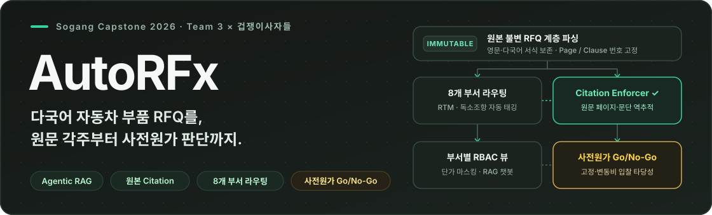

  

  <b>서강대학교 빅데이터종합설계(캡스톤디자인) 3조 × (주)겁쟁이사자들</b> 
  Immutable Source Preservation · Clause-Level Citation Enforcer · Pre-Cost Intelligence

  <a href="https://github.com/Sogang-RFx/AutoRFx"><b>프로젝트</b></a> &nbsp; · &nbsp;
  <a href="https://github.com/Sogang-RFx/AutoRFx/tree/main/src">소스코드</a> &nbsp; · &nbsp;
  <a href="https://github.com/Sogang-RFx/AutoRFx/tree/main/docs">아키텍처 문서</a> &nbsp; · &nbsp;
  <a href="https://github.com/Sogang-RFx/AutoRFx/issues">이슈 · 마일스톤</a>

---

## 배경

자동차 부품 협력사(Tier-1/Tier-2)는 글로벌 완성차(OEM)로부터 수백 페이지에 달하는 다국어 견적요청서(RFQ)를 접수합니다. OEM과 계약이 체결되면 3~6년 이상 장기 납품이 이어지기 때문에, 단일 조항이나 공차(Tolerance)·독소조항을 오역·누락할 경우 수년간 막대한 손실로 직결됩니다. 또한 부서별(연구개발·구매·품질·원가 등) 요구조건 분류와 중소기업이 가장 어려워하는 **사전원가(Pre-cost) 산출** 과정에서 극심한 실무 병목이 발생합니다.

## 개요

**AutoRFx는 대용량 다국어 자동차 부품 RFQ를 원본 훼손 없이 계층 파싱하여, 부서별 조항 라우팅·정밀 원문 각주(Citation) 추적·사전원가(Go/No-Go) 판단을 지원하는 Agentic RAG 플랫폼입니다.**

원본 불변(Immutable Original) 원칙 아래 요약·번역 조항을 클릭하면 원본 문서의 정확한 페이지와 문장 위치로 즉시 역추적할 수 있으며, 부서별 보안 권한 분리(RBAC)와 대화형 RAG 챗봇을 Streamlit 대시보드로 제공합니다.

## 팀

<table>
  <tr>
    <td align="center" width="20%" valign="top">
       
      <b>윤홍민</b> 
      <i>ID 확인 중</i>  
      PM · 기획 멘토링 · ROI
    </td>
    <td align="center" width="20%" valign="top">
       
      <b>박재현</b> 
      <a href="https://github.com/PJH720">@PJH720</a>  
      아키텍처 LangGraph · RAG
    </td>
    <td align="center" width="20%" valign="top">
       
      <b>조현모</b> 
      <a href="https://github.com/chm2333-png">@chm2333-png</a>  
      VectorDB 대시보드 UI
    </td>
    <td align="center" width="20%" valign="top">
       
      <b>강명서</b> 
      <a href="https://github.com/kangms0509">@kangms0509</a>  
      도메인 룰셋 독소조항 분석
    </td>
    <td align="center" width="20%" valign="top">
       
      <b>손채민</b> 
      <a href="https://github.com/bhbh0403">@bhbh0403</a>  
      용어사전 · 원가 정량 평가
    </td>
  </tr>
</table>

## 담당 범위 상세

| 담당 | 영역 | 상세 |
| :--- | :--- | :--- |
| **윤홍민** | PM · 비즈니스 기획 | WBS 일정 총괄, 산학 멘토((주)겁쟁이사자들) 요구사항 조율, 도입 ROI 및 비즈니스 모델 기획 |
| **박재현** | 아키텍처 · LangGraph · Citation | E2E 파이프라인 설계, 원본 불변(Immutable) 계층 파서·청커, LangGraph 부서 라우팅 에이전트, 조항 단위 정밀 Citation Enforcer 구현 |
| **조현모** | VectorDB · 웹 대시보드 | 과거 제안서 및 RFQ 임베딩·ChromaDB 검색 파이프라인 구축, Streamlit 기반 부서별 RBAC 뷰 및 RAG 챗봇 UI 개발 |
| **강명서** | 도메인 룰셋 · 독소조항 | 자동차 부품 조달 8개 부서 매핑 기준, RTM(Must/Should/Optional) 판정 규칙, 계약 독소조항 체크리스트 정립 |
| **손채민** | 용어사전 · 사전원가 · 평가 | 현업 실무 약어 사전, 사전원가(Pre-cost) Go/No-Go 산출 모델링, Golden Dataset 라벨링 및 정량 평가(Recall/Precision) |

## 리포지토리

| 이름 | 설명 | 링크 |
| :--- | :--- | :--- |
| **AutoRFx** | RFQ 계층 파서, LangGraph Agentic RAG, 사전원가 모델 및 Streamlit 대시보드 통합 저장소 | [저장소 보기](https://github.com/Sogang-RFx/AutoRFx) |
| **.github** | 팀 소개, R&R 및 프로젝트 개요를 게시하는 GitHub Organization 프로필 | [저장소 보기](https://github.com/Sogang-RFx/.github) |

---

  <b>Team Sogang-RFx</b> 
  Sogang University Capstone Design 2026 · Automotive RFx Intelligence

